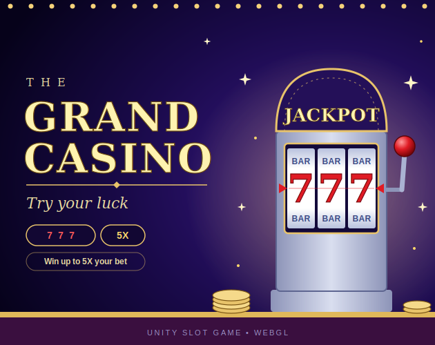
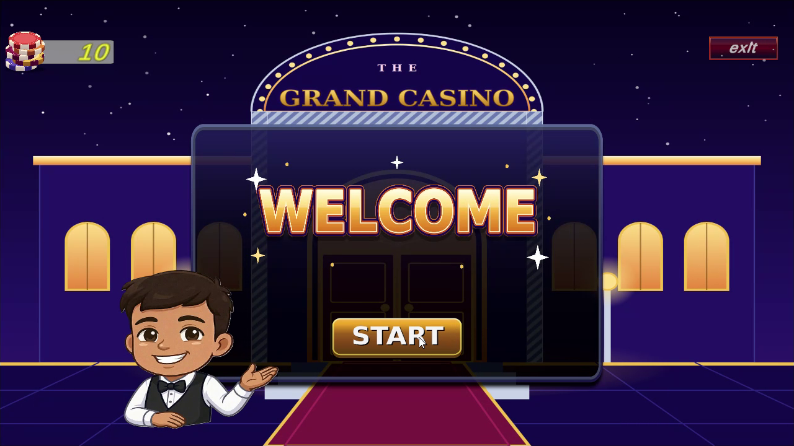
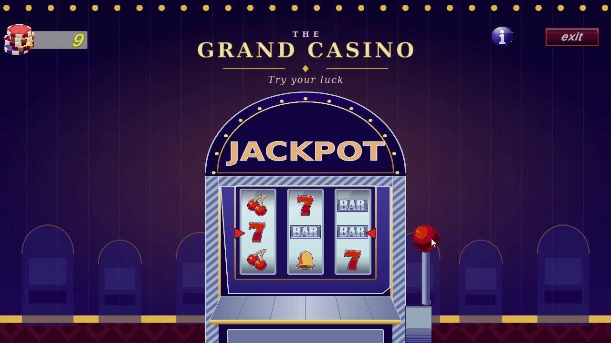
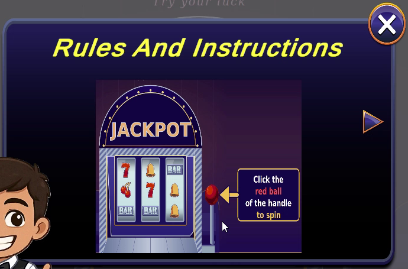
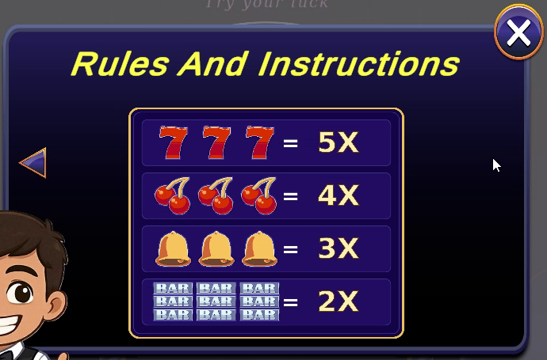
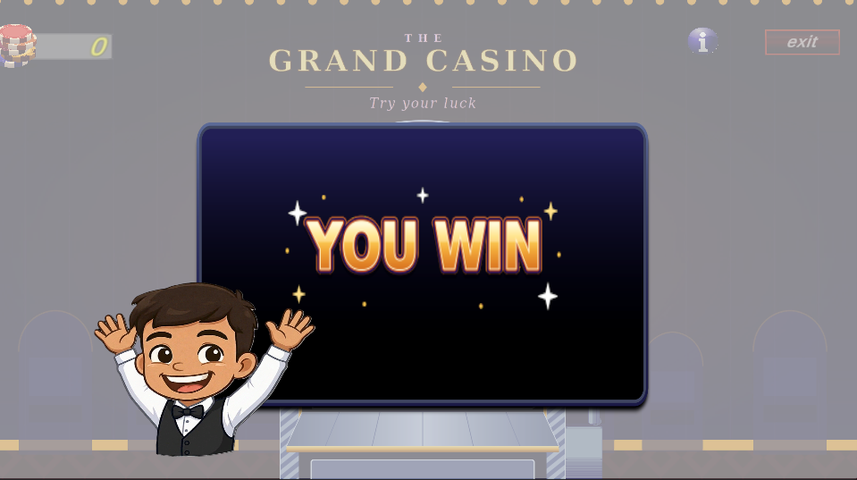
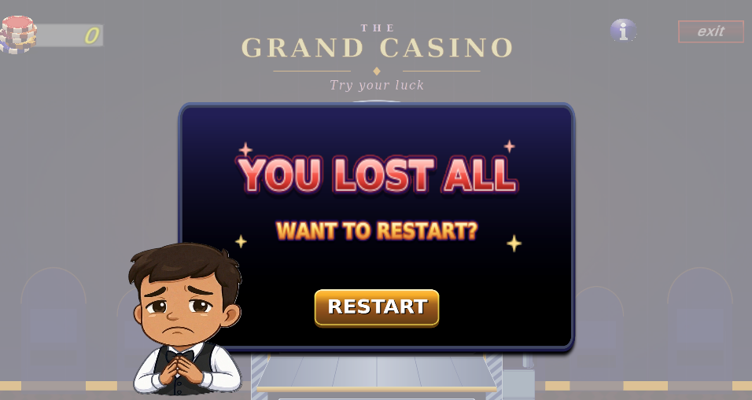
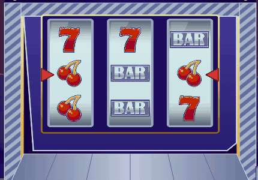
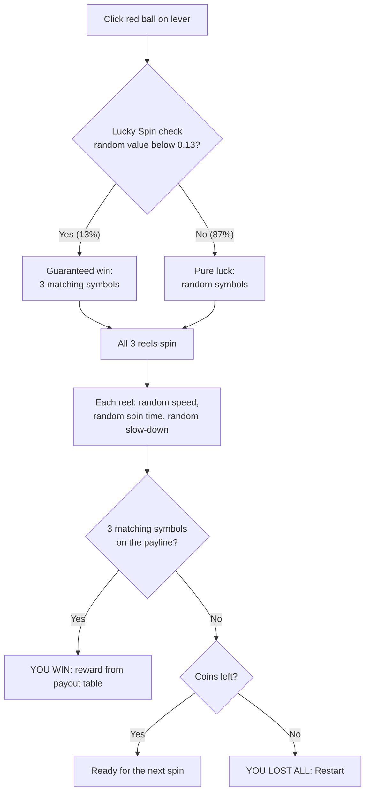

# 🎰 The Grand Casino: Unity Slot Game



### ▶️ [Play now in your browser on itch.io](https://ketan-dinkar.itch.io/slot-game)

No download or setup needed.

---

## Game Overview

**The Grand Casino** is a classic 3-reel slot machine built in Unity. You start with **10 coins**, and every spin costs **1 coin**. Click the red ball on the lever, watch the reels spin, and try to land **three matching symbols** on the payline. Match them and you win a multiplier reward. Run out of coins and it's game over, but the dealer will happily deal you back in.

A friendly dealer character reacts to what happens: he cheers when you win and looks heartbroken when you lose everything.

<p align="center">
  
  
</p>

---

## How to Play

The game teaches you the rules with a built-in **Rules & Instructions** popup.

<p align="center">
  
  
</p>

1. Press **Start** on the welcome screen.
2. Read the rules (use the arrows to switch pages), then close the popup.
3. Click the **red ball on the handle** to spin. Each spin costs **1 coin**.
4. If all **three symbols on the payline match**, you win the reward shown in the payout table.
5. Keep spinning until you run out of coins, then press **Restart** to play again.

The red arrows on both sides of the machine mark the **payline** (the middle row). Only that row counts.

---

## Winning Combinations & Payouts

You win when **all three symbols on the payline are the same**.

<table>
  <tr><th>Combination</th><th>Payout</th></tr>
  <tr><td></td><td><b>5X</b></td></tr>
  <tr><td></td><td><b>4X</b></td></tr>
  <tr><td></td><td><b>3X</b></td></tr>
  <tr><td></td><td><b>2X</b></td></tr>
</table>

Rarer, more valuable symbols pay more: **7s are the jackpot (5X)** and BARs are the smallest win (2X).

---

## Win & Lose Flow

| Result | What happens |
|---|---|
| **Three symbols match** | A **YOU WIN** popup appears, the dealer cheers, and the reward from the payout table is added to your coins. |
| **No match** | The spin costs 1 coin and play continues. You can spin again. |
| **Coins reach 0** | A **YOU LOST ALL** popup asks *"Want to restart?"*. The dealer looks sad, and pressing **Restart** starts a fresh game. |

<p align="center">
  
  
</p>

---

## How the Spinning Machine Works

<p align="center">
  
</p>

The goal was for the spin to feel like a real machine instead of a quick random number flash.

1. **Lever pull.** Clicking the red ball starts all three reels at the same moment.
2. **Fast spin with randomized speed.** Each reel scrolls its symbols quickly, and each reel gets its own randomized speed, so the three reels never move in perfect sync.
3. **Randomized spin time.** Every reel spins for its own random amount of time. In my tests a reel ran for roughly **2.5 to 6 seconds**, so the stopping order is different every spin: sometimes left first, sometimes right, sometimes the middle reel last. This builds suspense.
4. **Randomized slow-down.** A reel does not stop dead. When its time is up, it begins slowing down at a random moment, then settles onto a symbol lined up with the payline.
5. **Result check.** Once the last reel has stopped, the game checks whether the three payline symbols match, then shows the win or lose result.

**Sound:** a spinning sound plays while the reels turn, and a stop sound plays as each reel lands, so you can hear the reels finishing one by one.

### Lucky Spin System (win chance)

Pure randomness can feel harsh with only 10 coins, so the game includes a **Lucky Spin** system:

- On every spin there is a **13% chance (0.13)** that the Lucky Spin triggers.
- When it triggers, the spin is a **guaranteed win (100%)**: three matching symbols.
- On the other **87%** of spins, the result is **pure luck**: random symbols with no help.



If all four symbols are equally likely on a normal random spin, a normal spin matches about 6.25% of the time. With Lucky Spin added, the overall win rate is roughly **18%** (0.13 + 0.87 × 0.0625). The 0.13 value is a design choice and can be tuned to make the game easier or harder.

---

## Game Idea

A quick luck-based casino game with a simple loop: **spin → watch → win or lose → spin again**. The player has no skill input, so the fun comes from anticipation: the reels stopping one at a time, the sounds, and the dealer's reactions. A small coin budget (10) creates tension, and the 5X jackpot gives the player something to chase.

---

## Features
- 3-reel slot machine with smooth spinning and slowing animation
- Randomized speed, spin time, slow-down and stop order for every reel
- Randomized outcomes with a 13% Lucky Spin guaranteed win
- Four winning combinations with 2X to 5X payouts
- Rules & Instructions popup with a visual payout table
- Dealer character with win and lose reactions
- Coin counter, game-over popup and restart flow
- Spin and reel-stop sound effects
- Welcome screen, Info and Exit buttons

### Bonus Features
The **Lucky Spin** system (13% guaranteed win), the **dealer reactions**, and the **tiered payouts** go beyond the minimum requirements.

---

## How to Run the WebGL Build

**Option 1 (easiest): Play online**
👉 **https://ketan-dinkar.itch.io/slot-game**
Just open the link and click Start. It runs directly in the browser.

**Option 2: Run the included build locally**
Browsers block WebGL files opened straight from disk, so serve the folder with a local server:
```
cd Build/WebGL
python -m http.server 8000
```
Then open `http://localhost:8000`.

**Option 3: Open in Unity**
Add the project folder in Unity Hub, open the main scene in `Assets/Scenes/`, and press Play.

---

## Project Structure

```
Assets/
├── Scripts/     Game logic (reels, win check, coins, UI panels)
├── Prefabs/     Reusable game objects
├── Animations/  Reel, lever and dealer animations
├── UI/          Sprites and UI assets
└── Sounds/      Spin and reel-stop audio
Build/
└── WebGL/       Playable web build
docs/            Screenshots and images used in this README
```

---

## My Approach

1. **Core loop first.** I built spin → stop → check result → update coins before adding any polish.
2. **Separate responsibilities.** Reel spinning, win checking, coin balance and UI panels are kept in separate scripts so each is easy to read and change.
3. **Clear win rule.** A win is checked by comparing the three payline symbols, and each symbol type maps to a multiplier.
4. **Game feel.** Randomized reel speed, spin time and slow-down make each spin feel different, and the sounds and dealer reactions make results feel rewarding.
5. **Fair but fun.** Most spins are pure luck, while the 13% Lucky Spin keeps a short 10-coin game from feeling hopeless. It is documented here so the behavior is transparent.
6. **Complete experience.** Welcome screen, rules popup, win popup, game-over popup and restart make it a finished game, not just a spinning reel.

---

## Built With
- Unity *(add your version, e.g. 2022.3 LTS)*
- C#
- WebGL (hosted on itch.io)

## Author
*(Your name)* · [GitHub](https://github.com/your-username)
